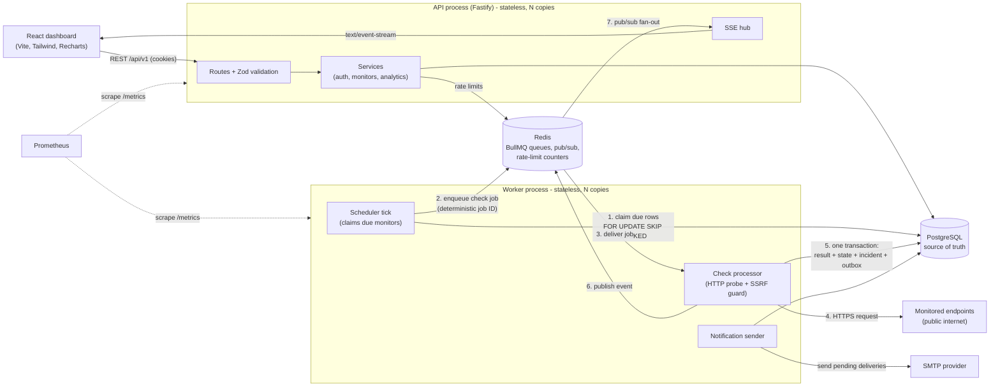
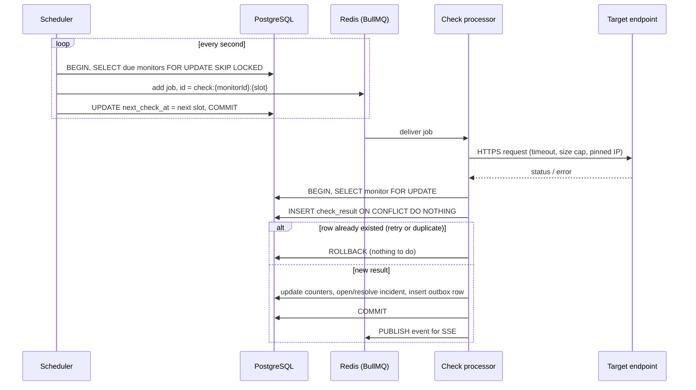
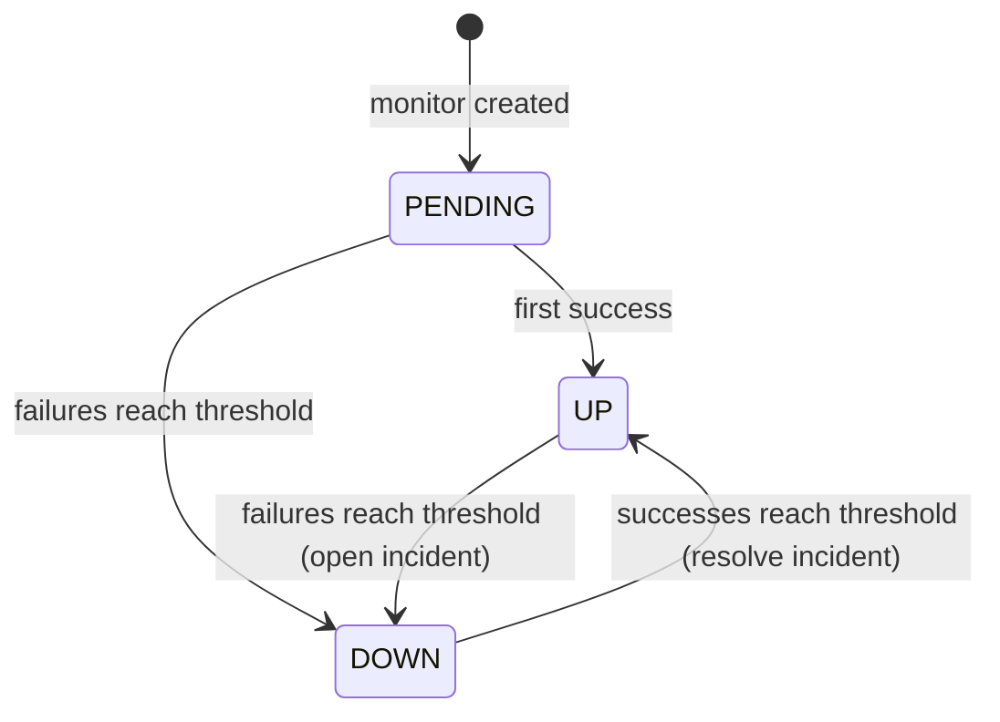

# PulseWatch Architecture

> Status: **Phase 1 (design)**. Nothing in this document is implemented yet.
> Each section says which phase builds it. The reasoning behind every choice,
> with alternatives, is in [ENGINEERING_DECISIONS.md](ENGINEERING_DECISIONS.md).

## 1. What the system does

PulseWatch checks HTTPS endpoints on a schedule, records each result, decides
when an endpoint is down or has recovered, and shows the history to its owner.

## 2. Requirements

### Functional

| #   | Requirement                                                                                                      |
| --- | ---------------------------------------------------------------------------------------------------------------- |
| F1  | Register, log in, log out; sessions can be revoked.                                                              |
| F2  | Create, list, view, update, pause and delete monitors (HTTPS URL + interval).                                    |
| F3  | Check every active monitor at its interval (minimum 60 s) without user action.                                   |
| F4  | Record status code, latency and failure reason for every check.                                                  |
| F5  | Open an incident after N consecutive failures (default 3); resolve it after M consecutive successes (default 2). |
| F6  | Show paginated check history and inspect a single check.                                                         |
| F7  | Show uptime %, average / median / p95 latency for 24 h, 7 d and 30 d.                                            |
| F8  | Push new results and status changes to the open dashboard.                                                       |
| F9  | Optionally email the owner when an incident opens or resolves, exactly once each.                                |

### Non-functional

| #   | Requirement                   | How it is met                                                                                  |
| --- | ----------------------------- | ---------------------------------------------------------------------------------------------- |
| N1  | **Correctness under retries** | One result per monitor per time slot, enforced by a unique constraint (ADR-003).               |
| N2  | **No duplicate incidents**    | Row lock on the monitor + partial unique index on open incidents (ADR-007).                    |
| N3  | **Survives restarts**         | Schedule lives in Postgres; jobs live in Redis with AOF; workers are stateless (ADR-002).      |
| N4  | **Tenant isolation**          | Every query on a user-owned resource is filtered by `user_id`; other users' IDs return 404.    |
| N5  | **Safe outbound requests**    | SSRF guard validates the IP actually connected to, not just the URL (ADR-009).                 |
| N6  | **Horizontal scalability**    | API and workers are stateless and can run as N copies; see section 7.                          |
| N7  | **Observability**             | Structured JSON logs with request/job IDs, Prometheus metrics, health and readiness endpoints. |
| N8  | **Honest measurement**        | Latency uses a monotonic clock; no benchmark is published unless it was actually run.          |

### Explicitly out of scope for the MVP

Multi-region probing, teams/organisations, non-HTTP checks (TCP, ping),
response-body assertions, status pages, SMS/Slack alerts. Listed so the
boundary is deliberate, not accidental.

## 3. System diagram



## 4. Components

| Component           | Responsibility                                                              | Phase |
| ------------------- | --------------------------------------------------------------------------- | ----- |
| `apps/api`          | Auth, validation, monitor CRUD, history and analytics queries, SSE stream.  | 2, 4  |
| `apps/worker`       | Scheduler tick, check execution, incident state machine, notification send. | 3, 4  |
| `apps/web`          | Dashboard UI.                                                               | 5     |
| `packages/database` | Prisma schema, migrations, client factory, test-database helper.            | 2     |
| `packages/shared`   | Zod schemas, domain constants and types used by more than one app.          | 2     |
| PostgreSQL          | All durable state. The only thing that must be backed up.                   | 2     |
| Redis               | Job queue, pub/sub, rate-limit counters. Rebuildable from Postgres.         | 3     |

**Why a modular monolith plus one worker, not microservices** (ADR-001): the
API and worker scale for different reasons (request rate vs. number of
monitors), so they are separate _processes_. Everything else shares one
codebase and one database, because splitting further would add network calls
and distributed-transaction problems with nothing measurable gained.

Inside each app the layering is the same and deliberately shallow:

```
route handler  ->  service (business rules)  ->  Prisma / Redis
(HTTP only)        (no HTTP types)               (I/O)
```

Route handlers translate HTTP to function calls and nothing else. Services
take their dependencies (database client, clock, queue) as arguments, which is
the only dependency injection the project needs: tests pass in a real test
database and a fake clock, with no DI framework.

## 5. Life of one check



Three properties fall out of this design:

1. **A check is identified by its slot, not by when it ran.** `slot` is the
   scheduled time. A retried job computes the same slot, so its insert hits the
   unique constraint and changes nothing. Retries cannot inflate check counts.
2. **Enqueue happens before the schedule advances.** If the scheduler crashes
   between the two, the monitor is still due and is claimed again; the
   duplicate job has the same ID and is dropped. The opposite order would lose
   a check on crash.
3. **A failed check is a result, not an error.** A timeout or a 503 is recorded
   and the job _succeeds_. Only infrastructure faults (database unreachable)
   make the job fail and retry. See ADR-003.

## 6. Incident state machine



A single failure does not flip an `UP` monitor to `DOWN`; it only increments
`consecutive_failures`. This hysteresis stops one dropped packet from paging
someone. The incident's `started_at` is back-dated to the first failure in the
streak so the recorded duration reflects the real outage.

## 7. Scaling: 100 to 100,000 monitors

Arithmetic at a 60 s interval (derived figures, **not** benchmarks):

| Monitors | Checks / second | Rows / day   | Rows at 30-day retention |
| -------- | --------------- | ------------ | ------------------------ |
| 100      | 1.7             | 144,000      | 4.3 million              |
| 10,000   | 167             | 14.4 million | 432 million              |
| 100,000  | 1,667           | 144 million  | 4.3 billion              |

| Scale       | What breaks first                                                                   | Response                                                                                                                                                                                              |
| ----------- | ----------------------------------------------------------------------------------- | ----------------------------------------------------------------------------------------------------------------------------------------------------------------------------------------------------- |
| **100**     | Nothing. One API, one worker, one Postgres.                                         | This is the MVP. Adding anything else here would be overengineering.                                                                                                                                  |
| **10,000**  | `check_results` size; analytics query time.                                         | Partition `check_results` by month (retention becomes `DROP PARTITION`); hourly rollup table for 30-day charts; run 2+ workers; cache analytics (ADR-010).                                            |
| **100,000** | Write throughput on one Postgres primary; one scheduler tick claiming 1,667 rows/s. | Read replica for analytics; batch inserts; shard the schedule by `hash(monitor_id)`; consider a time-series store for results. At this point a real capacity test, not arithmetic, drives the design. |

Checks are I/O-bound, so worker capacity is about concurrent sockets, not CPU.
Required concurrency is roughly `checks/second x average check duration`. The
worst case is when many targets are down and every check waits for its full
timeout, which is exactly when the system is most needed. That is why the
per-check timeout is capped at 30 s and worker concurrency is bounded
(back pressure: jobs wait in Redis instead of exhausting sockets or memory).

Mapping to the [System Design Primer](https://github.com/donnemartin/system-design-primer):

| Primer section                                   | Where it shows up here                                                           |
| ------------------------------------------------ | -------------------------------------------------------------------------------- |
| Performance vs scalability                       | Section 7: the MVP is fast for one user; the table shows what changes with load. |
| Latency vs throughput                            | Worker concurrency limit trades per-check queue delay for bounded resource use.  |
| Availability vs consistency (CAP)                | Postgres is CP for check state; SSE events are best-effort (ADR-006).            |
| Consistency patterns                             | Strong for incidents (transaction); eventual for dashboard pushes and caches.    |
| Availability patterns                            | Stateless API/worker copies; fail-over is "start another process".               |
| Load balancer / horizontal scaling               | No server-side session state, so any API copy can serve any request.             |
| Reverse proxy                                    | TLS termination and static assets in deployment (Phase 6).                       |
| Application layer / microservices                | ADR-001: why not microservices.                                                  |
| Database: SQL tuning, indexing                   | [docs/database.md](docs/database.md): each index is tied to a query.             |
| Database: replication, sharding, denormalization | Section 7 scale responses.                                                       |
| Cache: cache-aside                               | ADR-010: analytics caching, deferred until measured.                             |
| Asynchronism: task queues, back pressure         | ADR-002, ADR-003: BullMQ, bounded concurrency.                                   |
| Communication: REST                              | [docs/api.md](docs/api.md).                                                      |
| Security                                         | ADR-004 (sessions), ADR-009 (SSRF).                                              |

## 8. Security overview

Detailed threat handling is built in Phases 2 to 4; the design commitments are:

- **Passwords**: Argon2id. Hashes never leave the API process.
- **Sessions**: 15-minute access JWT and a rotating refresh token, both in
  `httpOnly`, `Secure`, `SameSite` cookies; refresh tokens are stored hashed
  and re-use revokes the token family (ADR-004).
- **Authorisation**: every query for a user-owned row includes `user_id`.
  A resource that exists but belongs to someone else returns `404`, so IDs
  cannot be probed.
- **SSRF**: monitored URLs are attacker-controlled input. HTTPS only, no
  redirects, DNS resolved once and the connection pinned to the validated IP,
  private / loopback / link-local / metadata / multicast ranges rejected for
  IPv4 and IPv6 (ADR-009).
- **Abuse limits**: Redis-backed rate limits on auth and write endpoints;
  per-user monitor cap; response-size cap on probes.
- **Errors**: one central error handler; clients get a stable error code and a
  request ID, never a stack trace.
- **Configuration**: environment variables are validated with Zod at start-up;
  the process refuses to start on a missing or malformed secret.

Before any public deployment the worker must also be isolated at the
**network** level (egress firewall denying private ranges). Application checks
are one layer, not the only one. This is tracked for Phase 6.

## 9. Repository layout (target)

```
pulsewatch/
  apps/
    api/        Fastify REST API + SSE
    worker/     scheduler, check processor, notifier
    web/        React dashboard
  packages/
    database/   Prisma schema, migrations, client, test helpers
    shared/     Zod schemas, constants, shared types
  docker/       Dockerfiles
  docs/         database.md, api.md, milestones.md, schema.sql
  load/         k6 scripts and recorded results (Phase 6)
  .github/workflows/
  docker-compose.yml
  ARCHITECTURE.md
  ENGINEERING_DECISIONS.md
  README.md
```
