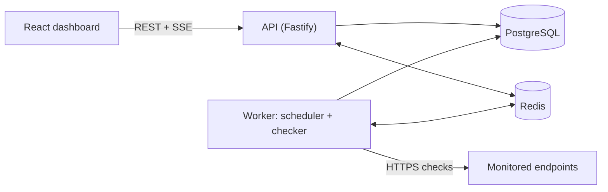

# PulseWatch

An API monitoring platform: it checks HTTPS endpoints on a schedule, records
status and latency, detects outages and recoveries, and shows the history on a
dashboard.

> **Project status: Phase 2 of 6 complete.** The database layer and the REST
> API (authentication and monitor management) exist and are tested. Nothing
> checks the monitored endpoints yet: the worker, incident detection and the
> UI are later phases. This README grows with the project and only describes
> what has actually been built and verified.

| Phase | Scope                                                | Status      |
| ----- | ---------------------------------------------------- | ----------- |
| 1     | Architecture, schema design, API design, decisions   | Done        |
| 2     | Backend foundation: Fastify, Prisma, auth, CRUD      | Done        |
| 3     | Monitoring engine: scheduler, workers, SSRF guard    | Not started |
| 4     | Reliability: incidents, alerts, rate limits, metrics | Not started |
| 5     | React dashboard                                      | Not started |
| 6     | Testing, load tests, CI/CD, deployment               | Not started |

## Documentation

| Document                                             | Contents                                                        |
| ---------------------------------------------------- | --------------------------------------------------------------- |
| [ARCHITECTURE.md](ARCHITECTURE.md)                   | Requirements, system diagram, check lifecycle, scaling analysis |
| [ENGINEERING_DECISIONS.md](ENGINEERING_DECISIONS.md) | Every significant decision: options, trade-offs, rationale      |
| [docs/database.md](docs/database.md)                 | Schema, relationships, index-to-query mapping, verification     |
| [docs/schema.sql](docs/schema.sql)                   | Reference DDL (PostgreSQL 16)                                   |
| [docs/api.md](docs/api.md)                           | REST endpoints, response and error conventions                  |
| [docs/milestones.md](docs/milestones.md)             | Build plan, broken into testable milestones                     |

## Architecture at a glance



A modular monolith with one separate worker process. PostgreSQL is the single
source of truth, including for the check schedule; Redis carries the job
queue, live-update fan-out and rate-limit counters, and can be rebuilt from
Postgres. Full detail in [ARCHITECTURE.md](ARCHITECTURE.md).

## Planned tech stack

| Layer      | Technology                                                  |
| ---------- | ----------------------------------------------------------- |
| Frontend   | React, TypeScript, Vite, Tailwind CSS, Recharts             |
| API        | Node.js 24, TypeScript, Fastify, Zod, OpenAPI               |
| Data       | PostgreSQL 16, Prisma                                       |
| Jobs       | Redis, BullMQ, dedicated worker process                     |
| Auth       | Argon2id, JWT access token + rotating refresh token         |
| Testing    | Vitest, Fastify inject, Testcontainers, k6                  |
| Operations | Docker Compose, GitHub Actions, Prometheus, structured logs |

## Local setup

Requirements: Node.js 24, and either Docker or a PostgreSQL 16 server.

```bash
corepack enable        # once per machine: puts pnpm on your PATH
pnpm install
pnpm build
```

On Windows, keep the project at a short path (for example `C:\dev\pulsewatch`).
pnpm's nested `node_modules` layout can exceed the 260-character path limit in
a deeply nested folder, which makes tools fail to start with misleading errors.

## Running the API

Copy `.env.example` to `.env`, set `DATABASE_URL` to a PostgreSQL 16 database
and `JWT_ACCESS_SECRET` to a random value of at least 32 characters
(`openssl rand -base64 48`), then apply the migrations and start the server:

```bash
pnpm db:migrate:deploy
pnpm dev:api
```

| URL                             | What it is                                        |
| ------------------------------- | ------------------------------------------------- |
| `http://127.0.0.1:3000/healthz` | Liveness probe                                    |
| `http://127.0.0.1:3000/readyz`  | Readiness probe (checks the database)             |
| `http://127.0.0.1:3000/docs`    | Interactive API documentation (not in production) |

The server refuses to start if a required variable is missing or malformed
and says which one.

## Running the checks

```bash
pnpm typecheck
pnpm lint
pnpm format:check
pnpm test
```

`pnpm test` includes integration tests that need a real PostgreSQL:

- **With Docker running**: nothing to configure. A throwaway
  `postgres:16-alpine` container is started and removed automatically.
- **Without Docker**: set `TEST_DATABASE_URL` to a server where the role may
  `CREATE DATABASE`. Each run creates its own database and drops it afterwards.

To check that the Prisma schema and the migrations agree, point `DATABASE_URL`
at a migrated database and run `pnpm db:check-drift`.

## Sections to be added as they become true

Environment configuration for the API and worker, screenshots, performance results, known limitations. Performance results will
be published only from load tests that were actually run, with the method and
hardware stated.
