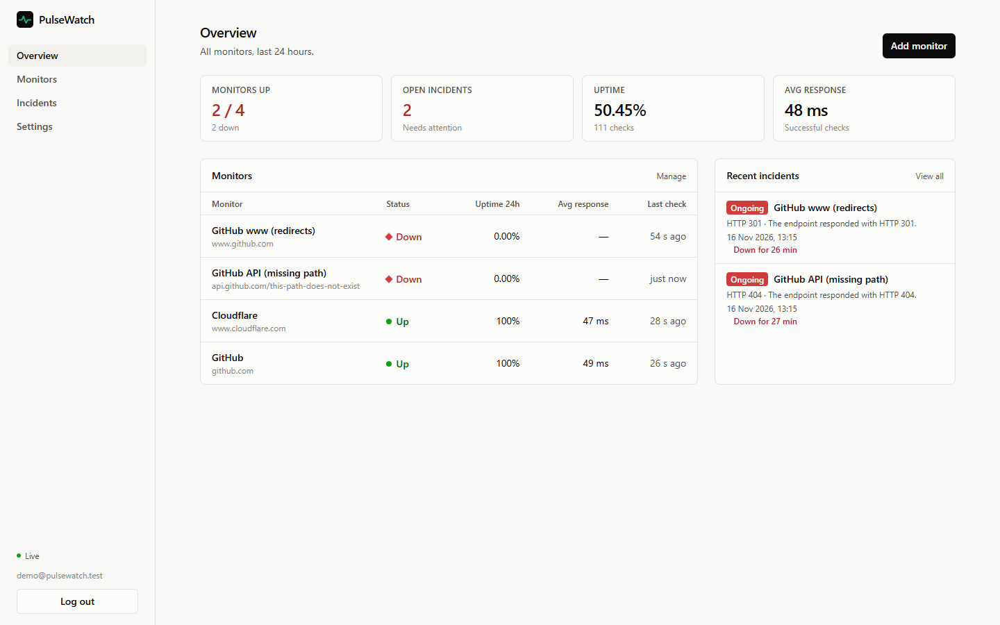
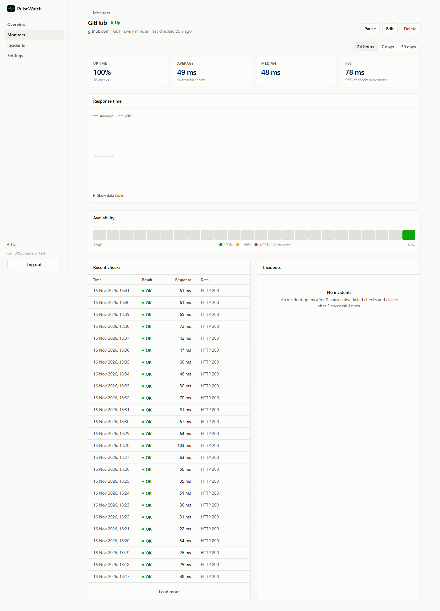
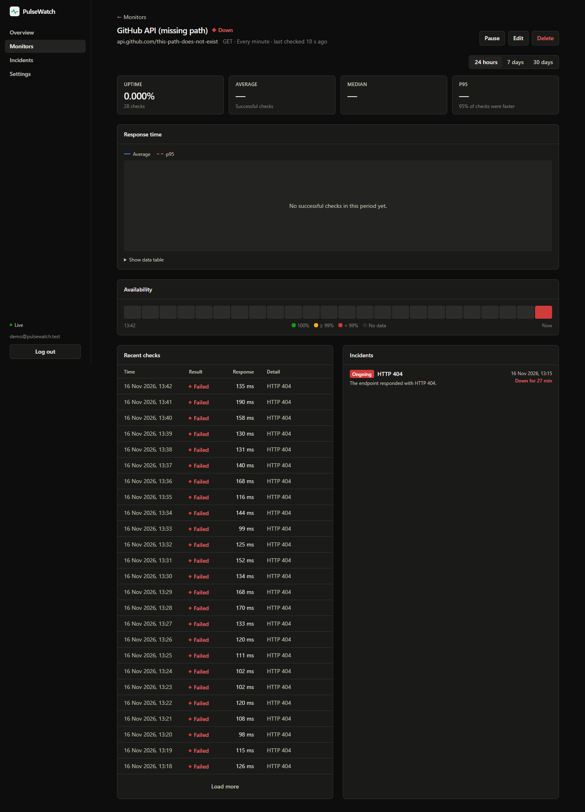
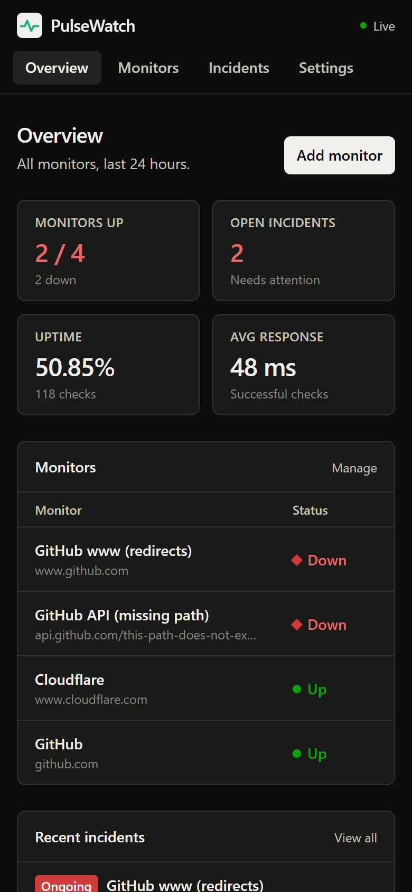
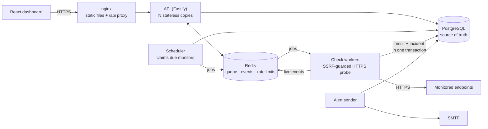

# PulseWatch

An API monitoring platform. PulseWatch checks your HTTPS endpoints on a
schedule, records every status code and response time, opens an incident when
an endpoint goes down and resolves it when it recovers, and shows uptime and
latency on a live dashboard.

It is a portfolio project built to production standards: a REST API, a
background worker with a job queue, PostgreSQL, Redis, a React dashboard,
containers and CI, with every significant decision written down in
[ENGINEERING_DECISIONS.md](ENGINEERING_DECISIONS.md).



## Features

- **Accounts:** registration and login with Argon2id password hashing,
  short-lived access tokens and rotating refresh tokens in `HttpOnly` cookies,
  with stolen-token detection.
- **Monitors:** HTTPS URL, check frequency (every minute to every hour),
  timeout, method, failure and recovery thresholds; pause, edit, delete.
- **Real checks:** a scheduler and a worker pool probe each endpoint and
  record the status code, response time (monotonic clock) and failure
  reason: timeout, DNS, connection, TLS, HTTP status or blocked address.
- **Incidents:** three consecutive failures mark a monitor down and open an
  incident dated from the first failure; two consecutive successes resolve it.
- **Analytics:** uptime, average, median and p95 response time over 24 hours,
  7 days or 30 days, computed in PostgreSQL, with a chart and an availability
  strip.
- **Live dashboard:** results and status changes arrive over Server-Sent
  Events without a reload.
- **Alerts (optional):** one email when an incident opens and one when it
  resolves, through a transactional outbox with retries.
- **Security:** SSRF protection at connection time (including DNS
  rebinding), per-user authorisation on every query, rate limiting shared
  across instances, a strict Content-Security-Policy, and validated
  configuration.

| Monitor detail                                         | During an outage (dark mode)                      | Phone                                               |
| ------------------------------------------------------ | ------------------------------------------------- | --------------------------------------------------- |
|  |  |  |

The screenshots show real results: four public endpoints checked every
minute for about half an hour. Two of them were chosen to fail (one returns
404, one redirects) to show incident detection.

## Architecture



A modular monolith with a separate worker process (ADR-001). PostgreSQL is
the single source of truth, including for the check schedule (ADR-002), so
Redis can be lost without losing anything that matters. Full detail, with
sequence diagrams and a scaling analysis from 100 to 100,000 monitors, is in
[ARCHITECTURE.md](ARCHITECTURE.md).

## Tech stack

| Layer      | Technology                                                                              |
| ---------- | --------------------------------------------------------------------------------------- |
| Frontend   | React 19, TypeScript, Vite, Tailwind CSS 4, TanStack Query, Recharts                    |
| API        | Node.js 24, Fastify 5, Zod 4 (validation and OpenAPI), Argon2id, JWT                    |
| Data       | PostgreSQL 16, Prisma 7                                                                 |
| Jobs       | Redis 7, BullMQ, a dedicated worker process                                             |
| Operations | Docker, Docker Compose, nginx, GitHub Actions, Prometheus metrics, structured JSON logs |
| Testing    | Vitest, Fastify `inject`, Testcontainers, k6                                            |

## Quick start: the whole stack in Docker

Requires Docker.

```bash
export JWT_ACCESS_SECRET="$(openssl rand -base64 48)"
docker compose --profile app up -d --build --wait
```

Open <http://localhost:8080>, create an account, and add a monitor. Its first
check runs within one interval (new monitors are spread across their first
minute on purpose), then every interval after that.

## Local development

Requires Node.js 24 and Docker. On Windows, keep the project at a short path:
pnpm's nested `node_modules` can exceed the 260-character path limit.

```bash
corepack enable                  # once per machine: provides pnpm
pnpm install
cp .env.example .env             # then set JWT_ACCESS_SECRET (openssl rand -base64 48)
pnpm infra:up                    # Postgres on 127.0.0.1:5433, Redis on 127.0.0.1:6379
pnpm db:migrate:deploy
```

Then, in three terminals:

```bash
pnpm dev:api        # http://127.0.0.1:3000 (API docs at /docs)
pnpm dev:worker
pnpm dev:web        # http://localhost:5173
```

### Configuration

Every variable is documented in [.env.example](.env.example). Each process
validates its configuration at start-up and refuses to start, naming the
problem, if anything required is missing or malformed. It never prints
secret values.

| Variable                     | Used by     | Default                 | Notes                                                 |
| ---------------------------- | ----------- | ----------------------- | ----------------------------------------------------- |
| `DATABASE_URL`               | api, worker | (required)              | PostgreSQL connection string                          |
| `REDIS_URL`                  | api, worker | (required)              | Redis connection string                               |
| `JWT_ACCESS_SECRET`          | api         | (required)              | At least 32 random characters                         |
| `APP_ORIGIN`                 | api         | `http://localhost:5173` | The dashboard's origin, for the CSRF check            |
| `RATE_LIMIT_PER_MINUTE`      | api         | 300                     | Per client IP                                         |
| `AUTH_RATE_LIMIT_PER_MINUTE` | api         | 10                      | Login and registration, per client IP                 |
| `TRUST_PROXY`                | api         | `false`                 | Only behind a proxy that overwrites `X-Forwarded-For` |
| `WORKER_CONCURRENCY`         | worker      | 20                      | Checks in flight per worker process                   |
| `RETENTION_DAYS`             | worker      | 30                      | Minimum 30, the longest analytics range               |
| `SMTP_URL`, `MAIL_FROM`      | worker      | (unset)                 | Without SMTP, alert emails go to the log              |

## API

REST under `/api/v1`, JSON in and out, one error shape everywhere, cursor
pagination. In development the full OpenAPI 3.1 reference, generated from
the same Zod schemas that validate requests, is at
<http://127.0.0.1:3000/docs>.

| Area     | Endpoints                                                                                                                                            |
| -------- | ---------------------------------------------------------------------------------------------------------------------------------------------------- |
| Auth     | `POST /auth/register`, `/auth/login`, `/auth/refresh`, `/auth/logout`; `GET /auth/me`                                                                |
| Monitors | `POST /monitors`, `GET /monitors`, `GET/PATCH/DELETE /monitors/:id`                                                                                  |
| History  | `GET /monitors/:id/checks`, `/monitors/:id/checks/:checkId`, `/monitors/:id/analytics?range=`, `/monitors/:id/incidents`, `/incidents`, `/dashboard` |
| Settings | `GET/PUT /settings/notifications`                                                                                                                    |
| Live     | `GET /events` (Server-Sent Events)                                                                                                                   |
| Internal | `GET /healthz`, `/readyz`, `/metrics` (not exposed by nginx)                                                                                         |

Conventions and reasoning: [docs/api.md](docs/api.md).

## Database

Seven tables: users, refresh tokens, monitors, check results, incidents,
notification settings and notification deliveries. Rules that must never be
broken are database constraints, not only application code: one result per
monitor per time slot, at most one open incident per monitor, HTTPS-only
URLs, and well-formed results. Every index is tied to a named query.
Schema, relationships, index rationale and the uptime definition:
[docs/database.md](docs/database.md).

## Testing

```bash
pnpm typecheck && pnpm lint && pnpm format:check
pnpm test:unit
pnpm test:integration     # starts throwaway PostgreSQL and Redis containers
```

| Package             | Tests | What they cover                                                                                                                                                                                                |
| ------------------- | ----- | -------------------------------------------------------------------------------------------------------------------------------------------------------------------------------------------------------------- |
| `apps/worker`       | 173   | SSRF guard (every blocked range, IPv6 forms, rebinding), prober against a local HTTPS server, scheduler concurrency, idempotent processing, incident state machine, alert outbox and sender, retention, config |
| `apps/api`          | 147   | Auth flows and token attacks, per-user authorisation on every endpoint, validation, analytics against hand-computed figures, pagination, rate limiting across instances, live events, metrics                  |
| `packages/shared`   | 39    | Shared validation rules                                                                                                                                                                                        |
| `packages/database` | 26    | Every constraint, cascade and race, against real PostgreSQL                                                                                                                                                    |
| `apps/web`          | 27    | API client session refresh rules, formatting                                                                                                                                                                   |

Integration tests use real PostgreSQL and Redis, never mocks (ADR-015).
Concurrency controls were checked by removing each one and confirming a
test failed; two did not at first, so tests were added (ADR-022).

## Performance

Load-tested with k6 through the full stack (nginx, API, PostgreSQL) on one
machine (Intel i7-13700, Docker Desktop), with 1.7 million rows of check
history:

| Target load                           | Requests | Failed | Dashboard p95 | Analytics p95 |
| ------------------------------------- | -------- | ------ | ------------- | ------------- |
| 600 requests/s for 60 s (+ 15 s ramp) | 40,798   | 0      | 13.8 ms       | 30.1 ms       |

The first runs failed: one exposed a sequential scan (70 ms, fixed to 6.7 ms
with an index-friendly query), the next exposed nginx running out of ports.
Method, hardware, all three runs and what was not tested:
[load/README.md](load/README.md).

## Engineering challenges

Problems found during development, mostly by tests or by running the system
under real conditions, and how each was resolved:

| Problem                                                                             | How it was found                      | Fix                                                       |
| ----------------------------------------------------------------------------------- | ------------------------------------- | --------------------------------------------------------- |
| Timestamps read back an hour off during summer time                                 | A test with a daylight-saving instant | Pin every database session to UTC (ADR-013)               |
| Validation ran before authentication, telling anonymous callers about request shape | A 401 test got 422                    | Authenticate at the first lifecycle stage (ADR-020)       |
| Protected endpoints were not rate-limited at all                                    | A test expected a 429                 | One app-level limiter hook that runs first (ADR-024)      |
| `SKIP LOCKED` and the monitor row lock had no test that failed without them         | Removing each control on purpose      | Targeted concurrency tests (ADR-022)                      |
| A new monitor's chart looked empty while it had data                                | Looking at real results               | Draw isolated points (ADR-025)                            |
| Dashboard query scanned the whole results table                                     | Load test, then `EXPLAIN ANALYZE`     | `monitor_id = ANY($ids)`: 70 ms to 6.7 ms (ADR-025)       |
| nginx exhausted its ports under load (81% errors)                                   | Second load test                      | Upstream connection pool with DNS re-resolution (ADR-025) |
| API image was 739 MB                                                                | Inspecting the image                  | Stop auto-installing optional peers: 435 MB (ADR-026)     |
| Worker refused to start in Compose                                                  | Running the containers                | Treat an empty optional setting as unset (ADR-026)        |

## Security

The threat model and the controls in place are summarised in
[ARCHITECTURE.md, section 8](ARCHITECTURE.md#8-security-overview), with
details in ADR-004 (sessions), ADR-009 and ADR-021 (SSRF), ADR-020
(authorisation) and ADR-024 (rate limiting). Requirements before any public
deployment, including network-level egress rules for the worker, are in
[docs/deployment.md](docs/deployment.md).

## Known limitations

- **Not deployed publicly.** Everything has run locally in Docker; the
  deployment guide is written but unverified on a real host. The CI workflow
  passes `actionlint` but has not run on GitHub.
- **Email is unverified.** Alerts go only to the account's own address, and
  registration reveals whether an email is taken.
- **No password reset or email verification.**
- **Redirects are not followed.** A `3xx` counts as a failure; monitor the
  final URL.
- **Headers only.** An endpoint that sends healthy headers and then fails
  mid-body is reported as up. There are no response-body assertions.
- **An access token stays valid for up to 15 minutes after logout,** the cost
  of verifying tokens without a database lookup.
- **One region.** All checks come from one place, so a network problem near
  the worker looks like an outage.

## Future improvements

- Partition `check_results` by month and add hourly rollups for 30-day charts
  once data volume calls for it (ARCHITECTURE.md, section 7).
- Multi-region probing, with an incident only when several regions agree.
- Email verification and password reset; Slack and webhook alerts.
- Response assertions (status ranges, body contents, certificate expiry).
- Public status pages.

## Documentation

| Document                                             | Contents                                                        |
| ---------------------------------------------------- | --------------------------------------------------------------- |
| [ARCHITECTURE.md](ARCHITECTURE.md)                   | Requirements, diagrams, check lifecycle, scaling analysis       |
| [ENGINEERING_DECISIONS.md](ENGINEERING_DECISIONS.md) | 26 decisions: options, trade-offs, results, interview questions |
| [docs/database.md](docs/database.md)                 | Schema, relationships, index-to-query mapping                   |
| [docs/api.md](docs/api.md)                           | REST conventions and reasoning                                  |
| [docs/deployment.md](docs/deployment.md)             | Deployment, security requirements, operations                   |
| [load/README.md](load/README.md)                     | Load-test method and results                                    |
| [docs/milestones.md](docs/milestones.md)             | How the project was built, phase by phase                       |
