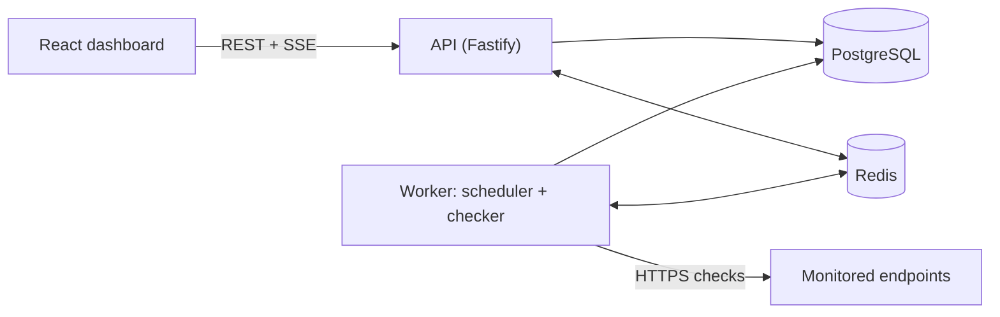

# PulseWatch

An API monitoring platform: it checks HTTPS endpoints on a schedule, records
status and latency, detects outages and recoveries, and shows the history on a
dashboard.

> **Project status: Phase 3 of 6 complete.** The REST API and the monitoring
> engine exist and are tested: monitors are checked on schedule over HTTPS and
> every result is stored. Status changes, incidents, alerts and the UI do not
> exist yet, so a monitor's status stays PENDING for now. This README grows
> with the project and only describes what has actually been built and
> verified.

| Phase | Scope                                                | Status      |
| ----- | ---------------------------------------------------- | ----------- |
| 1     | Architecture, schema design, API design, decisions   | Done        |
| 2     | Backend foundation: Fastify, Prisma, auth, CRUD      | Done        |
| 3     | Monitoring engine: scheduler, workers, SSRF guard    | Done        |
| 4     | Reliability: incidents, alerts, rate limits, metrics | Not started |
| 5     | React dashboard                                      | Not started |
| 6     | Testing, load tests, CI/CD, deployment               | Not started |

## Documentation

| Document                                             | Contents                                                        |
| ---------------------------------------------------- | --------------------------------------------------------------- |
| [ARCHITECTURE.md](ARCHITECTURE.md)                   | Requirements, system diagram, check lifecycle, scaling analysis |
| [ENGINEERING_DECISIONS.md](ENGINEERING_DECISIONS.md) | Every significant decision: options, trade-offs, rationale      |
| [docs/database.md](docs/database.md)                 | Schema, relationships, index-to-query mapping, verification     |
| [docs/schema.sql](docs/schema.sql)                   | Reference DDL (PostgreSQL 16)                                   |
| [docs/api.md](docs/api.md)                           | REST endpoints, response and error conventions                  |
| [docs/milestones.md](docs/milestones.md)             | Build plan, broken into testable milestones                     |

## Architecture at a glance



A modular monolith with one separate worker process. PostgreSQL is the single
source of truth, including for the check schedule; Redis carries the job
queue, live-update fan-out and rate-limit counters, and can be rebuilt from
Postgres. Full detail in [ARCHITECTURE.md](ARCHITECTURE.md).

## Planned tech stack

| Layer      | Technology                                                  |
| ---------- | ----------------------------------------------------------- |
| Frontend   | React, TypeScript, Vite, Tailwind CSS, Recharts             |
| API        | Node.js 24, TypeScript, Fastify, Zod, OpenAPI               |
| Data       | PostgreSQL 16, Prisma                                       |
| Jobs       | Redis, BullMQ, dedicated worker process                     |
| Auth       | Argon2id, JWT access token + rotating refresh token         |
| Testing    | Vitest, Fastify inject, Testcontainers, k6                  |
| Operations | Docker Compose, GitHub Actions, Prometheus, structured logs |

## Local setup

Requirements: Node.js 24 and Docker.

```bash
corepack enable        # once per machine: puts pnpm on your PATH
pnpm install
pnpm build
```

On Windows, keep the project at a short path (for example `C:\dev\pulsewatch`).
pnpm's nested `node_modules` layout can exceed the 260-character path limit in
a deeply nested folder, which makes tools fail to start with misleading errors.

## Running it locally

Start PostgreSQL and Redis, then copy `.env.example` to `.env` and set
`JWT_ACCESS_SECRET` to a random value of at least 32 characters
(`openssl rand -base64 48`). The other defaults match the Compose file.

```bash
pnpm infra:up            # Postgres on 127.0.0.1:5433, Redis on 127.0.0.1:6379
pnpm db:migrate:deploy
pnpm dev:api             # in one terminal
pnpm dev:worker          # in another
```

| URL                             | What it is                                        |
| ------------------------------- | ------------------------------------------------- |
| `http://127.0.0.1:3000/healthz` | Liveness probe                                    |
| `http://127.0.0.1:3000/readyz`  | Readiness probe (checks the database)             |
| `http://127.0.0.1:3000/docs`    | Interactive API documentation (not in production) |

Create a monitor through `/docs` and the worker checks it within a second or
two, then again every interval. `pnpm infra:down` stops the containers; data
is kept in named volumes.

Both processes refuse to start if a required variable is missing or malformed
and says which one.

## Running the checks

```bash
pnpm typecheck
pnpm lint
pnpm format:check
pnpm test
```

`pnpm test` includes integration tests that need a real PostgreSQL and Redis:

- **With Docker running**: nothing to configure. Throwaway containers are
  started and removed automatically (Testcontainers).
- **Against servers you already have running**: set `TEST_DATABASE_URL` (a
  role that may `CREATE DATABASE`) and `TEST_REDIS_URL`. Each run creates
  its own database and drops it afterwards, and uses uniquely named queues.

To check that the Prisma schema and the migrations agree, point `DATABASE_URL`
at a migrated database and run `pnpm db:check-drift`.

## Sections to be added as they become true

Environment configuration for the API and worker, screenshots, performance results, known limitations. Performance results will
be published only from load tests that were actually run, with the method and
hardware stated.
