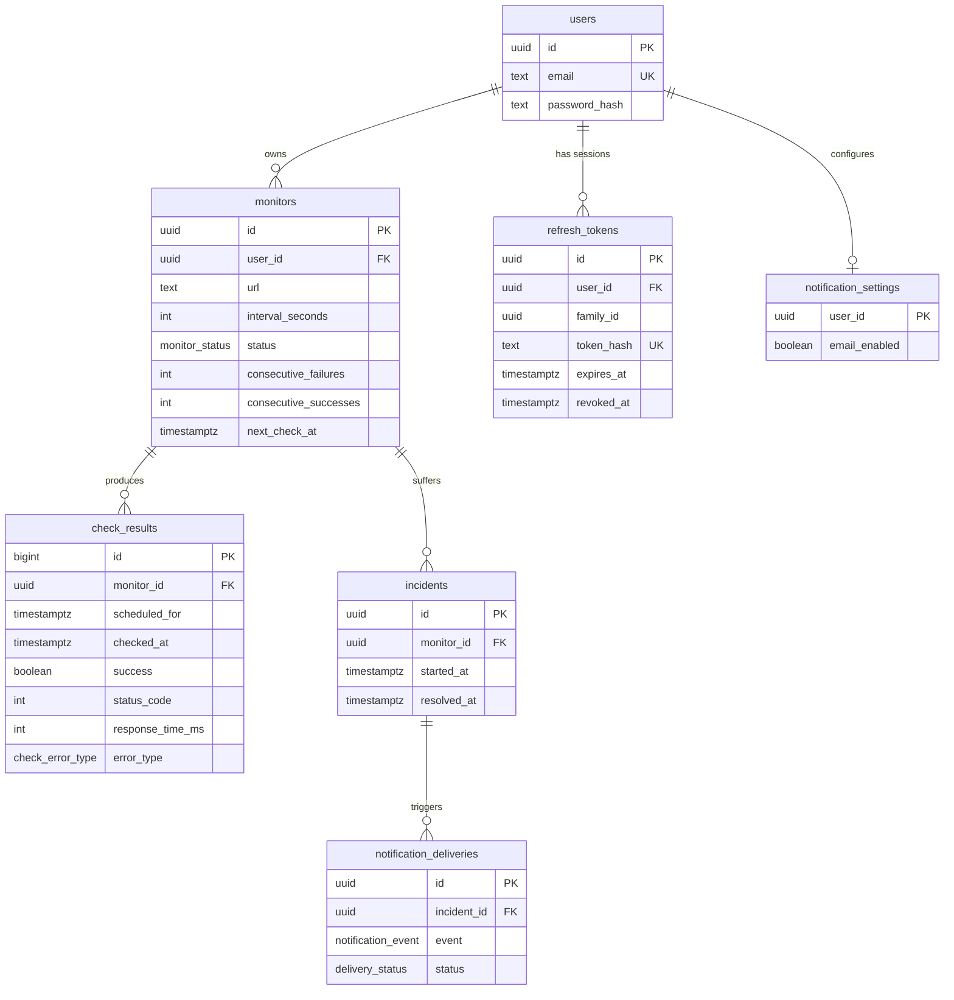

# Database design

PostgreSQL 16. The executable reference DDL is [schema.sql](schema.sql); this
document explains it. In Phase 2 the schema is expressed in Prisma and its
migrations become the source of truth.

## Entity relationships



All foreign keys are `ON DELETE CASCADE`: deleting a user removes their
monitors, and deleting a monitor removes its results and incidents. Account
deletion is therefore one statement and cannot leave orphans.

## Decisions worth explaining

### 1. Constraints live in the database

The API validates input with Zod, but validation in application code only
protects one code path. The worker, a migration script or a future service
also write to these tables. So the rules that must _never_ be broken are
`CHECK`, `UNIQUE` and foreign-key constraints: HTTPS-only URLs, interval of at
least 60 s, one open incident per monitor, one result per slot.

### 2. `timestamptz` everywhere

`timestamp` (without time zone) stores a wall-clock reading with no indication
of which zone it was read in. `timestamptz` stores an absolute instant
(internally UTC) and is unambiguous across servers and daylight-saving
changes. Prisma's default for `DateTime` is the unsafe one, so the Prisma
schema will annotate every column with `@db.Timestamptz`.

### 3. Each index exists for a named query

| Index                                                           | Query it serves                                            |
| --------------------------------------------------------------- | ---------------------------------------------------------- |
| `users (email)` unique                                          | Login lookup; duplicate-registration guard.                |
| `refresh_tokens (token_hash)` unique                            | Refresh: find the presented token.                         |
| `refresh_tokens (family_id)`                                    | Revoke a whole family on token re-use.                     |
| `monitors (user_id, created_at DESC)`                           | "List my monitors."                                        |
| `monitors (next_check_at) WHERE paused = false`                 | Scheduler: "which monitors are due?"                       |
| `check_results (monitor_id, scheduled_for)` unique              | Idempotency **and** history **and** analytics range scans. |
| `check_results USING brin (scheduled_for)`                      | Retention: delete rows older than N days.                  |
| `incidents (monitor_id) WHERE resolved_at IS NULL` unique       | "Is there an open incident?" and the duplicate guard.      |
| `incidents (monitor_id, started_at DESC)`                       | Incident history.                                          |
| `notification_deliveries (incident_id, event, channel)` unique  | Send-once guarantee.                                       |
| `notification_deliveries (created_at) WHERE status = 'PENDING'` | Sender sweep for unsent rows.                              |

Indexes are not free: each one is extra work on every insert. That matters
most on `check_results`, which receives nearly all the writes.

### 4. One B-tree on the hot table, not two

The obvious design has a unique index on `(monitor_id, scheduled_for)` for
idempotency _and_ an index on `(monitor_id, checked_at)` for time-range
queries. Instead, history and analytics filter on `scheduled_for`, so the
unique index does both jobs.

Trade-off: a check that ran 3 s late is attributed to its scheduled slot
rather than the instant it ran. For uptime over 24 hours that difference is
irrelevant, and `checked_at` is still stored, so queue lag stays measurable.

### 5. `bigint` identity for `check_results`, UUID for everything else

User-facing IDs (monitors, incidents) are random UUIDs so they cannot be
enumerated (`/monitors/42` invites trying `/monitors/43`). `check_results`
rows are only reached through their monitor, so guessability does not matter;
an 8-byte sequential key keeps the primary-key index half the size and
append-only. The API serialises it as a string because a 64-bit integer does
not fit safely in a JavaScript number.

### 6. Partial indexes

`WHERE paused = false`, `WHERE resolved_at IS NULL` and `WHERE status =
'PENDING'` index only the rows a query can match. The pending-deliveries index
stays tiny forever even though the table grows without bound. The partial
_unique_ index on open incidents is also a correctness tool: it expresses "at
most one open incident per monitor", which a normal unique constraint cannot.

Prisma's schema language cannot describe partial indexes or `CHECK`
constraints, so these are added as hand-written SQL inside the migration, and
CI will run a drift check to prove the schema and migrations still agree.

### 7. Current state is denormalised onto `monitors`

`status`, `consecutive_failures` and `consecutive_successes` could be derived
by reading the latest check results. Storing them means the dashboard reads
one row per monitor instead of scanning history, and the state machine does
not re-count on every check. The cost is that they must be updated in the same
transaction as the check insert, which the worker does while holding a row
lock on the monitor.

### 8. `notification_deliveries` is a transactional outbox

The delivery row is inserted in the _same transaction_ that opens or resolves
the incident. Either both exist or neither does, so an alert cannot be lost
between "incident committed" and "email job queued", and the unique key stops
a retry sending it twice. See ADR-008.

## Uptime definition

```
uptime % = successful checks / recorded checks x 100     (within the window)
```

Slots with no recorded check (worker was down, monitor was paused) are
**excluded**, not counted as downtime: no data is not evidence of an outage.
To keep that honest, analytics also returns `expectedChecks` (window length /
interval) alongside `totalChecks`, so the UI can show when coverage is
incomplete rather than silently presenting 100% from three data points.

Latency statistics (average, median, p95) are computed over **successful**
checks only. A timeout's "latency" is just the timeout setting and would
distort the percentiles.

## Retention

A nightly job deletes `check_results` older than the retention period
(default 30 days, matching the longest analytics window) in batches, so no
single transaction holds locks for long. Incidents are kept indefinitely; they
are small and are the long-term record.

## Verification performed in Phase 1

The DDL was loaded into a temporary PostgreSQL 16.x cluster (the locally
installed binaries, on a separate port and data directory) and exercised with
a script. Observed results:

| Check                                                          | Result                                                       |
| -------------------------------------------------------------- | ------------------------------------------------------------ |
| Schema loads without error                                     | OK                                                           |
| Duplicate email                                                | Rejected (`users_email_key`)                                 |
| Mixed-case email                                               | Rejected (`users_email_lowercase`)                           |
| `http://` URL                                                  | Rejected (`monitors_url_https`)                              |
| Interval of 59 s                                               | Rejected (`monitors_interval_range`)                         |
| Second result for the same monitor + slot                      | Rejected (`check_results_monitor_slot_key`)                  |
| Same, with `ON CONFLICT DO NOTHING`                            | `INSERT 0 0` (silently skipped)                              |
| Failure without `error_type`; success without `status_code`    | Both rejected                                                |
| Second open incident for one monitor                           | Rejected (`incidents_one_open_per_monitor`)                  |
| New incident after the previous one is resolved                | Accepted                                                     |
| `resolved_at` earlier than `started_at`                        | Rejected                                                     |
| Duplicate notification for the same incident + event + channel | Rejected                                                     |
| Deleting a user                                                | Monitors, results, incidents, deliveries all removed         |
| 24 h analytics on 504,000 rows (50 monitors x 7 days)          | Plan uses `check_results_monitor_slot_key`, reads 1,440 rows |
| Keyset history page (50 rows, newest first)                    | `Index Scan Backward` on the same index, reads 50 rows       |

One result to be straightforward about: the scheduler's due-monitor query
used a sequential scan in this test. With only 51 monitors, all of them due,
that is the correct plan, so the test does **not** demonstrate
`monitors_due_idx` being used. That will be checked in Phase 3 with a
realistic number of monitors of which only a few are due.

These were plan inspections, not timing benchmarks. No latency figures are
claimed.
